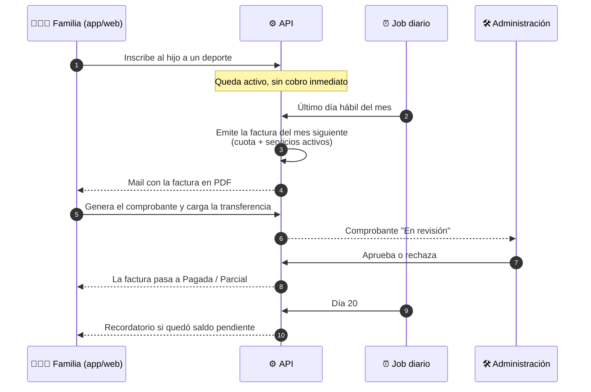
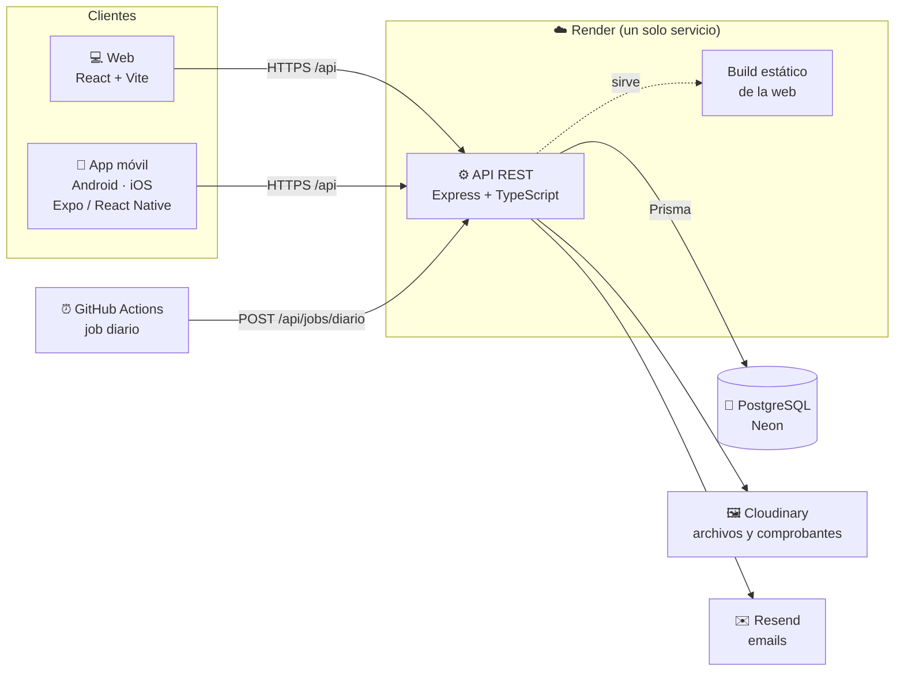
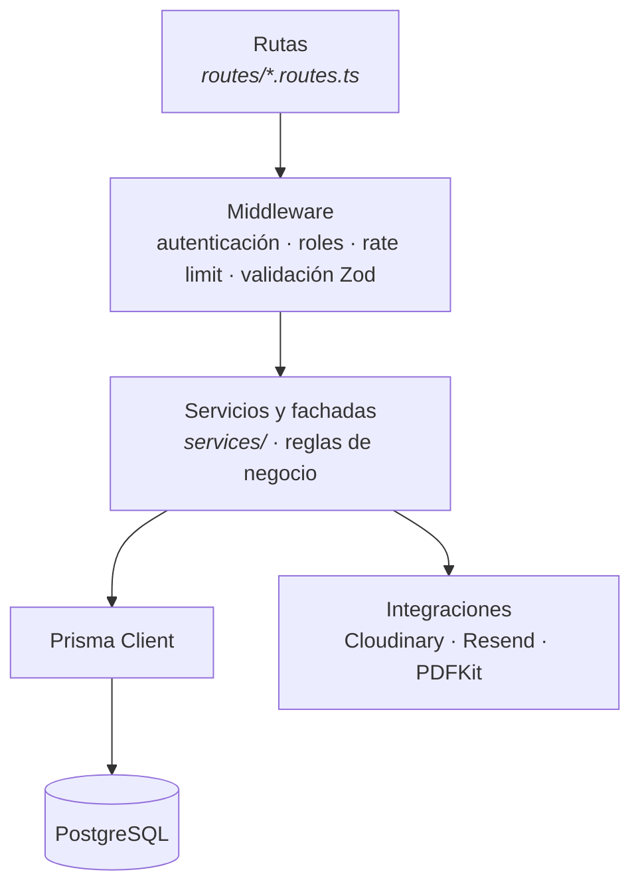

<div align="center">

# 🎓 Educar para Transformar

### Plataforma de gestión educativa integral: sitio institucional, campus virtual y app para familias

Una sola plataforma para que la escuela, los docentes, los alumnos y las familias trabajen conectados:
calificaciones, asistencia, servicios, facturación y pagos, todo en un mismo lugar.

[](https://educar-para-transformar-iffe.onrender.com)
[](https://expo.dev/accounts/lauoporto/projects/educar-para-transformar/builds/41e607c9-e712-48f6-a16c-fdd53da8aaed)
[](#-probar-la-app-en-ios)


</div>

---

## 📑 Contenido

- [Sobre el proyecto](#-sobre-el-proyecto)
- [Funcionalidades](#-funcionalidades)
- [Tecnologías](#-tecnologías)
- [Arquitectura](#-arquitectura)
- [Instalar la app en Android (APK)](#-instalar-la-app-en-android-apk)
- [Probar la app en iOS](#-probar-la-app-en-ios)
- [Ejecutar el proyecto localmente](#-ejecutar-el-proyecto-localmente)
- [Usuarios de prueba](#-usuarios-de-prueba)
- [Calidad y testing](#-calidad-y-testing)
- [Estructura del repositorio](#-estructura-del-repositorio)
- [Despliegue](#-despliegue)
- [Equipo](#-equipo)

---

## 🏫 Sobre el proyecto

**Educar para Transformar** es una plataforma pensada para un instituto educativo con nivel **Inicial, Primaria y Secundaria**, que necesita digitalizar su gestión diaria sin perder la cercanía con las familias.

Reúne tres productos que comparten una única API y una única base de datos:

| | Producto | Para quién | Qué resuelve |
|---|---|---|---|
| 🌐 | **Sitio institucional** | Público general | Presenta la escuela, sus niveles e instalaciones; publica noticias y recibe consultas, preinscripciones y postulaciones laborales. |
| 💻 | **Campus virtual** | Administración, docentes, alumnos y familias | Gestión académica, asistencia, servicios complementarios, facturación, pagos y reportes en PDF. |
| 📱 | **App para familias** (Android e iOS) | Padres y tutores | Estado de cuenta, pago de cuotas por transferencia e inscripción de los hijos a deportes, transporte y comedor, desde el celular. |

> 💡 **Una sola fuente de verdad.** La web y la app consumen la misma API REST: lo que una familia hace desde el celular se ve al instante en el campus, y viceversa.

---

## ✨ Funcionalidades

<details open>
<summary><b>🌐 Sitio institucional</b></summary>

- Secciones de presentación: nosotros, niveles educativos, bienestar estudiantil e instalaciones.
- **Noticias** administradas desde el panel (alta, edición, publicación y baja).
- **Formulario de contacto** con aviso por mail a la escuela y botón directo a WhatsApp.
- **Preinscripción online** de alumnos, **opiniones** de la comunidad (moderadas) y **"Trabajá con nosotros"** con carga de CV.
- Galería de imágenes.

</details>

<details>
<summary><b>🛠️ Administración</b></summary>

- **Usuarios y roles**: altas, aprobación de cuentas docentes y vínculos padre–hijo.
- **Estructura académica**: niveles, cursos, materias, asignación docente–materia–curso y **horario semanal de cursado**, con detección de superposiciones.
- **Servicios**: deportes y sus grupos (día, horario, nivel y profesor), recorridos de transporte y turnos de comedor, cada uno con su precio mensual.
- **Facturación mensual automática** y revisión de pagos: aprobar o rechazar transferencias con su comprobante adjunto.
- **Reportes en PDF**: 14 reportes académicos, de servicios y financieros (alumnos por curso, por docente, por deporte o recorrido, ingresos por período, pagos completos e incompletos, etc.).
- **Auditoría** de las acciones sensibles y moderación de preinscripciones, opiniones y postulaciones.
- Gestión de **noticias** y **consultas web**.

</details>

<details>
<summary><b>👩‍🏫 Docentes</b></summary>

- Carga de **calificaciones** por instancia y de **asistencia** diaria, con historial.
- **Planes de estudio** por materia (con archivo adjunto).
- Vista de sus cursos con el **horario semanal**.

</details>

<details>
<summary><b>🧑‍🎓 Alumnos</b></summary>

- **Boletín** de calificaciones, asistencias y planes de estudio.
- Perfil con su **horario de cursado**.
- Autogestión de servicios: deportes, transporte y comedor.

</details>

<details>
<summary><b>👨‍👩‍👧 Familias (web y app)</b></summary>

- Boletín, materias, horario y asistencia de cada hijo.
- **Alerta automática** ante 3 inasistencias consecutivas sin justificar, por notificación interna o por email, según la preferencia de cada familia.
- **Estado de cuenta** con la deuda discriminada por ítem (cuota, deporte, transporte y comedor).
- **Pago por transferencia**: se genera un comprobante con los datos bancarios y se carga la transferencia con una foto o un PDF del banco.
- Inscripción a servicios, con el precio y el mes desde el que se cobra.

</details>

### 💳 Ciclo de facturación

Las inscripciones no se cobran al momento: se suman a la factura mensual siguiente. Así funciona el circuito completo:



---

## 🧰 Tecnologías

| Capa | Tecnologías |
|---|---|
| **Backend** | Node.js 22 · Express 4 · TypeScript · Prisma ORM 6 · Zod (validación) · JWT + bcrypt · PDFKit · Multer · Helmet · express-rate-limit |
| **Base de datos** | PostgreSQL 16+ (Neon en producción) |
| **Web** | React 18 · React Router 6 · Tailwind CSS 3 · Vite 5 |
| **Mobile** | Expo SDK 58 · React Native 0.88 · TypeScript · expo-router · TanStack Query · expo-secure-store |
| **Servicios externos** | Cloudinary (archivos) · Resend (emails) · EAS Build (Android e iOS) |
| **Infraestructura** | Render (API + web) · GitHub Actions (CI y jobs programados) |
| **Calidad** | node:test (unit) · Jest + Testing Library (mobile) · Cypress (E2E) · ESLint · Prettier · Husky + lint-staged · SonarCloud |
| **Monorepo** | pnpm workspaces (backend + client) · npm (mobile, independiente) |

---

## 🏗️ Arquitectura

### Vista general



- **Un solo despliegue para la web y la API**: el backend sirve el build de React desde el mismo puerto, así no hace falta un servidor aparte para el frontend.
- **La app móvil no tiene backend propio**: usa la misma API, identificándose con el header `X-Client-Type: mobile`.
- **Jobs programados externos**: el hosting gratuito apaga el servicio sin tráfico, por eso la emisión de facturas y los recordatorios los dispara GitHub Actions todos los días a las 8:00 (hora de Argentina), con un secreto compartido.

### Capas del backend



### Patrones de diseño

Cada patrón se aplicó donde había una variación real que convenía aislar:

| Patrón | Dónde | Qué resuelve |
|---|---|---|
| 🧩 **Facade** | `services/panelFamilia.facade.ts`<br/>`services/pagos.facade.ts` | Una sola llamada combina el catálogo de servicios con las inscripciones del alumno, o el estado de cuenta completo, y aplica las reglas de negocio: máximo 2 deportes, sin superposición horaria y sin duplicados. |
| 📊 **Strategy** | `services/reportes/` | Los 14 reportes en PDF comparten una interfaz (`ReportStrategy`). Para sumar uno nuevo alcanza con agregar un archivo, sin tocar el motor ni las rutas. |
| 🏭 **Factory Method** | `services/notificaciones/` | Las alertas por inasistencias se envían por notificación interna o por email según la preferencia de cada familia. La fábrica decide el canal, y el servicio de asistencia no lo conoce. |

### Seguridad

- 🔐 **Sesiones con JWT**: un access token de 15 minutos (en memoria) y un refresh token que rota en cada uso. En la app se guarda en el almacenamiento seguro del dispositivo; en la web, en una cookie `httpOnly`.
- 🔑 Contraseñas con **bcrypt** y recuperación por código enviado por email.
- 🛡️ **Helmet**, **CORS** con lista blanca y **rate limiting** en la recuperación de contraseña y el formulario de contacto.
- 👥 **Control de acceso por rol** en cada endpoint. Un padre solo ve a sus hijos vinculados y un docente, solo sus cursos.
- 📎 Los archivos subidos se validan por su **contenido real** (no solo por la extensión) y los comprobantes se sirven con **URLs firmadas** que vencen a los 5 minutos.
- 📝 **Auditoría** de altas, bajas y cambios de precios.

---

## 📲 Instalar la app en Android (APK)

La app para familias se instala directamente desde un archivo `.apk`, sin pasar por Google Play.

> **Requisitos:** un celular con **Android 10 o superior** y conexión a internet.

**1. Abrí el link de descarga desde el celular**

👉 **[Descargar Educar para Transformar (APK)](https://expo.dev/accounts/lauoporto/projects/educar-para-transformar/builds/41e607c9-e712-48f6-a16c-fdd53da8aaed)**

También podés abrir el link en la computadora y escanear con el celular el código QR que aparece en la página.

**2. Descargá el archivo**

Tocá **Install** (o **Download**). El navegador puede advertir que el archivo podría ser dañino; es el aviso habitual para apps que no vienen de Google Play. Confirmá con **Descargar de todas formas**.

**3. Permití la instalación de apps desconocidas**

Al abrir el archivo descargado, Android te va a pedir permiso:

1. Tocá **Configuración** en el aviso.
2. Activá **Permitir de esta fuente** para tu navegador (por ejemplo, Chrome).
3. Volvé atrás.

> La ruta exacta cambia según la marca. Si no aparece el aviso, buscala en *Ajustes → Aplicaciones → Acceso especial → Instalar apps desconocidas*.

**4. Instalá la app**

Tocá **Instalar**. Si **Google Play Protect** muestra un aviso, elegí **Más detalles → Instalar de todas formas**.

**5. Abrí la app e iniciá sesión**

Buscá **Educar para Transformar** en tu menú de aplicaciones e ingresá con tu usuario y contraseña de padre o tutor. Para probarla, podés usar la [cuenta de demostración](#-usuarios-de-prueba).

> ⏳ **El primer ingreso puede tardar hasta un minuto**: el servidor de demostración se "duerme" cuando no hay uso. La app lo avisa con una franja que dice *"Despertando el servidor…"*.

<details>
<summary><b>¿Problemas para instalar?</b></summary>

| Problema | Solución |
|---|---|
| *"App no instalada"* | Ya tenés instalada una versión anterior firmada de otra forma: desinstalala y volvé a instalar. |
| *"Se bloqueó la instalación"* | Revisá el paso 3: el navegador necesita permiso para instalar apps desconocidas. |
| No encuentro el archivo | Buscalo en la app **Archivos** → **Descargas**. |
| *"No pudimos conectarnos con el servidor"* | Revisá la conexión a internet y esperá unos segundos: puede que el servidor se esté despertando. |

</details>

<details>
<summary><b>Generar un APK nuevo (para desarrolladores)</b></summary>

El APK se compila en la nube con **EAS Build**. El perfil `preview` de `mobile/eas.json` ya apunta a la API de producción.

```bash
cd mobile
npx eas-cli login       # una sola vez, con la cuenta de Expo del proyecto
npm run build:apk       # al terminar, EAS entrega el link y el QR de descarga
```

</details>

---

## 🍏 Probar la app en iOS

La app es multiplataforma: el mismo código corre en iPhone y usa **la misma API y los mismos datos** que la versión de Android y la web. Una transferencia cargada desde iOS aparece al instante en el campus y en Android.

El `.apk` es exclusivo de Android. Para iOS hay dos caminos, y ninguno necesita una Mac ni una cuenta paga de Apple:

| Opción | Necesitás | Ideal para |
|---|---|---|
| **A. Simulador en el navegador** | Una computadora y una cuenta gratuita de Appetize.io | Probar sin tener un iPhone |
| **B. Expo Go** | Un iPhone con Expo Go y el proyecto corriendo en tu PC | Verla en un iPhone real |

### Opción A · iPhone virtual en el navegador (Appetize.io)

**1. Descargá el build para simulador**

👉 **[Descargar Educar para Transformar para simulador iOS (.tar.gz)](https://expo.dev/accounts/lauoporto/projects/educar-para-transformar/builds/198fe00e-7b13-4678-bade-735e8c72daaf)**

En la página del build, tocá **Download**. No hace falta descomprimir el archivo.

**2. Subilo a Appetize**

1. Entrá a **[appetize.io](https://appetize.io)** y creá una cuenta gratuita.
2. Tocá **Upload** y elegí el archivo `.tar.gz` que descargaste. Appetize detecta solo que es una app de iOS.

**3. Abrí el iPhone virtual**

Elegí un modelo de iPhone y tocá **Tap to play**. La app arranca en el navegador y se maneja con el mouse.

**4. Iniciá sesión**

Usá la [cuenta de demostración](#-usuarios-de-prueba) `pbarrabino` / `123456`. El primer ingreso puede tardar hasta un minuto mientras se despierta el servidor.

> 📷 **El simulador no tiene cámara.** Para cargar una transferencia, usá **"Elegir de la galería"** (el simulador trae fotos de ejemplo) o **"Elegir PDF"**, en lugar de **"Sacar foto"**.

> El plan gratuito de Appetize tiene minutos de uso limitados por mes; alcanzan para recorrer la app completa.

### Opción B · En un iPhone real con Expo Go

1. En el iPhone, instalá **[Expo Go](https://apps.apple.com/app/expo-go/id982107779)** desde la App Store.
2. En tu computadora, con el proyecto clonado e instalado ([paso 7 de la ejecución local](#paso-7--ejecutar-la-app-móvil-opcional)), ejecutá:

   ```bash
   cd mobile
   npx expo start --tunnel
   ```

   El modo `--tunnel` permite que el iPhone se conecte aunque no esté en la misma red Wi-Fi. La primera vez te puede pedir instalar un paquete adicional: aceptá.
3. Escaneá el código QR de la terminal con la **cámara** del iPhone y abrilo con Expo Go.

> Si no creaste `mobile/.env.local`, la app usa la API de producción, con los mismos datos que la versión de Android.

<details>
<summary><b>Diferencias con Android</b></summary>

| Tema | En iOS |
|---|---|
| Volver atrás | iPhone no tiene tecla atrás: se usa el botón **Volver** de cada pantalla o se desliza desde el borde izquierdo. |
| Avisos y confirmaciones | Se ven con el estilo nativo de Apple, con las mismas opciones. |
| Compartir PDFs | Se abre el menú de compartir de iOS (Guardar en Archivos, AirDrop, WhatsApp…). |
| Permisos | La primera vez que uses la cámara o la galería, iOS te pide permiso con un mensaje que explica para qué se usa. |

</details>

<details>
<summary><b>Generar un build nuevo para simulador iOS (para desarrolladores)</b></summary>

El perfil `ios-simulador` de `mobile/eas.json` compila en la nube de Expo una versión para el simulador de iOS. No requiere una Mac ni credenciales de Apple.

```bash
cd mobile
npx eas-cli build --platform ios --profile ios-simulador
```

Al terminar, EAS entrega el link del `.tar.gz`. Sirve para Appetize.io o para el simulador de Xcode, en una Mac. Instalar la app en iPhones reales (TestFlight o App Store) requiere una cuenta de **Apple Developer**.

</details>

---

## 💻 Ejecutar el proyecto localmente

### Requisitos previos

| Herramienta | Versión | Para qué |
|---|---|---|
| [Git](https://git-scm.com/) | cualquiera | Clonar el repositorio |
| [Node.js](https://nodejs.org/) | **22.13 o superior** | Backend, web y app |
| [pnpm](https://pnpm.io/) | 9 o superior (se activa con Corepack) | Dependencias del monorepo |
| [PostgreSQL](https://www.postgresql.org/download/) | 16 o superior | Base de datos |
| [Expo Go](https://expo.dev/go) *(opcional)* | última | Probar la app en el celular |

### Paso 1 · Clonar el repositorio

```bash
git clone https://github.com/LauOporto/CentroEducativo-EducarParaTransformar.git
cd CentroEducativo-EducarParaTransformar
```

### Paso 2 · Instalar las dependencias

```bash
corepack enable     # habilita pnpm (viene con Node.js)
pnpm install        # instala backend y web, y genera el cliente de Prisma
```

### Paso 3 · Configurar las variables de entorno

Copiá el archivo de ejemplo:

```bash
# macOS / Linux / Git Bash
cp backend/.env.example backend/.env

# Windows (PowerShell)
Copy-Item backend/.env.example backend/.env
```

Abrí `backend/.env` y completá como mínimo:

| Variable | Qué poner |
|---|---|
| `DATABASE_URL` | Reemplazá `TU_PASSWORD` por la contraseña de tu usuario de PostgreSQL. |
| `JWT_ACCESS_SECRET` y `JWT_REFRESH_SECRET` | Dos secretos distintos, de al menos 32 caracteres. |
| `STORAGE_DRIVER` | Descomentala con el valor `local` para guardar los comprobantes de pago en disco, sin necesidad de Cloudinary. |

Para generar cada secreto:

```bash
node -e "console.log(require('crypto').randomBytes(48).toString('hex'))"
```

<details>
<summary><b>Variables opcionales</b></summary>

| Variable | Uso | Sin configurar |
|---|---|---|
| `CLOUDINARY_*` | Galería, CVs y planes de estudio | La app arranca, pero esas cargas fallan. Para desarrollo alcanza con una cuenta gratuita. |
| `RESEND_API_KEY` | Envío real de emails | Los mails se muestran completos en la consola del backend. |
| `MAIL_REDIRECT_TO` | Redirige todos los mails a una casilla de prueba | Se envían a cada destinatario real. |
| `BANCO_*` | Datos bancarios de las facturas | Se usan datos ficticios de demostración. |
| `FERIADOS_EXTRA` | Feriados puente que no se calculan solos | Solo se consideran los feriados nacionales. |
| `CRON_SECRET` | Protege el endpoint de jobs diarios | El endpoint queda deshabilitado. |

</details>

### Paso 4 · Crear la base de datos

```bash
psql -U postgres -c "CREATE DATABASE educar_transformar_db;"
```

> También podés crearla desde **pgAdmin**: clic derecho en *Databases → Create → Database*.

### Paso 5 · Aplicar las migraciones y cargar los datos de ejemplo

```bash
pnpm --filter backend prisma:migrate            # crea las tablas
pnpm --filter backend prisma:seed               # usuarios, cursos, materias, notas, servicios, noticias y horarios
pnpm --filter backend prisma:seed-facturacion   # precios, facturas y pagos de ejemplo (opcional)
```

### Paso 6 · Levantar la web y la API

```bash
pnpm dev
```

Este comando levanta el backend y la web en paralelo, con recarga automática.

| Servicio | URL |
|---|---|
| 🌐 Web | **http://localhost:5173** |
| ⚙️ API | http://localhost:4000/api |
| ❤️ Health check | http://localhost:4000/health |

Ingresá con cualquiera de los [usuarios de prueba](#-usuarios-de-prueba). 🎉

<details>
<summary><b>Alternativa: un solo proceso, igual que en producción</b></summary>

```bash
pnpm run client:build    # compila la web en client/dist
pnpm run backend:dev     # la API sirve también la web
```

Abrí **http://localhost:4000**. No tiene recarga automática de la web: hay que volver a compilar después de cada cambio.

</details>

### Paso 7 · Ejecutar la app móvil *(opcional)*

La app vive en `mobile/` y usa **npm** (está fuera del workspace de pnpm).

```bash
cd mobile
npm install
```

Para que use tu backend local, creá el archivo `mobile/.env.local`:

```bash
# Desde un celular: la IP de tu computadora en la red Wi-Fi (no "localhost")
EXPO_PUBLIC_API_URL=http://192.168.0.10:4000

# Desde el navegador de la computadora
# EXPO_PUBLIC_API_URL=http://localhost:4000
```

> Si no creás este archivo, la app usa la API de producción.

Iniciá el servidor de desarrollo:

```bash
npx expo start
```

- 📱 **En el celular:** abrí **Expo Go** y escaneá el código QR de la terminal. El celular y la computadora tienen que estar en la misma red Wi-Fi.
- 🌐 **En el navegador:** presioná `w`. En ese caso, agregá `http://localhost:8081` a `CORS_ORIGIN` en `backend/.env`.

### Comandos útiles

```bash
pnpm --filter backend prisma:studio   # explorador visual de la base de datos
pnpm --filter backend db:reset        # borra la base y la vuelve a crear con los datos de ejemplo
pnpm --filter backend typecheck       # chequeo de tipos del backend
pnpm build                            # compila la web y el backend para producción
pnpm lint                             # ESLint en todo el monorepo
```

---

## 👥 Usuarios de prueba

Todos los usuarios de los datos de ejemplo tienen la contraseña **`123456`**. El login acepta usuario o email.

| Rol | Usuario | Para probar |
|---|---|---|
| 🛠️ Administración | `admin` | Panel completo, facturación, pagos y reportes *(solo local)* |
| 👩‍🏫 Docente | `mlopez` | Calificaciones, asistencia y planes de estudio |
| 🧑‍🎓 Alumno | `fbarrabino` | Boletín, horario y servicios |
| 👨‍👩‍👧 Familia | `pbarrabino` | Un hijo, con facturas pagada, parcial y pendiente |
| 👨‍👩‍👧 Familia | `mgomezp` | Dos hijos, para probar el selector de hijo |

> 📱 La **app móvil** solo permite el ingreso de padres y tutores. En la **demo en vivo** podés entrar con `pbarrabino` / `123456`.

---

## ✅ Calidad y testing

| Tipo | Herramienta | Comando |
|---|---|---|
| Unitarios del backend | `node:test` + cobertura | `pnpm test` |
| Unitarios y de pantallas de la app | Jest + Testing Library | `cd mobile && npm test` |
| End-to-end | Cypress, contra una base aislada | `pnpm build && pnpm e2e` |
| Estilo y tipos | ESLint · Prettier · `tsc` | `pnpm lint` · `pnpm --filter backend typecheck` |

**Integración continua.** Cada pull request y cada push a `main` ejecutan en GitHub Actions el lint, el chequeo de tipos, los tests con cobertura, el build de la web y del backend, los tests de la app y la suite E2E contra un PostgreSQL efímero.

**Antes de cada commit**, Husky y lint-staged formatean y revisan los archivos modificados. La rama `main` está protegida: los cambios entran por pull request, con el CI en verde.

---

## 📁 Estructura del repositorio

```
.
├── backend/                 API REST (Express + TypeScript + Prisma)
│   ├── prisma/              esquema, migraciones y datos de ejemplo
│   └── src/
│       ├── routes/          endpoints por dominio
│       ├── middleware/      autenticación, roles y carga de archivos
│       ├── services/        reglas de negocio, fachadas, reportes y notificaciones
│       └── utils/           fechas, feriados, montos y validaciones
├── client/                  web en React + Vite + Tailwind
│   ├── src/pages/           público, admin, docente, estudiante y padre
│   └── cypress/             pruebas end-to-end
├── mobile/                  app Android para familias (Expo + React Native)
│   └── src/
│       ├── app/             pantallas (expo-router)
│       ├── pagos/           estado de cuenta, comprobantes y transferencias
│       └── lib/             cliente HTTP y sesión
├── scripts/                 E2E y métricas del repositorio
├── .github/workflows/       CI y jobs diarios
├── render.yaml              infraestructura como código (Render)
└── DEPLOY.md                guía de despliegue paso a paso
```

---

## 🚀 Despliegue

| Componente | Plataforma | Detalle |
|---|---|---|
| API + web | **Render** | Definido en [`render.yaml`](render.yaml). Se despliega solo cuando el CI de `main` pasa. |
| Base de datos | **Neon** | PostgreSQL administrado. Las migraciones se aplican al iniciar el servicio. |
| Archivos | **Cloudinary** | Almacenamiento persistente; los comprobantes de pago son privados. |
| Emails | **Resend** | Envío por API HTTPS. |
| Jobs diarios | **GitHub Actions** | Emisión de facturas y recordatorios de deuda. |
| App Android | **EAS Build** | APK de distribución directa. |
| App iOS | **EAS Build** | Build para simulador, que se prueba en el navegador con Appetize.io. |

La guía completa, con las variables de entorno de cada servicio, está en **[DEPLOY.md](DEPLOY.md)**.

---

## 🤝 Equipo

Desarrollado por el equipo **FLCODE**:

| Integrante |
|---|
| **Lautaro Oporto** |
| **Franco Barrabino** |
| **Facundo Jáuregui** |

---

<div align="center">

**Educar para Transformar** · Hecho con 💙 para la comunidad educativa

© 2026 Equipo FLCODE

</div>
